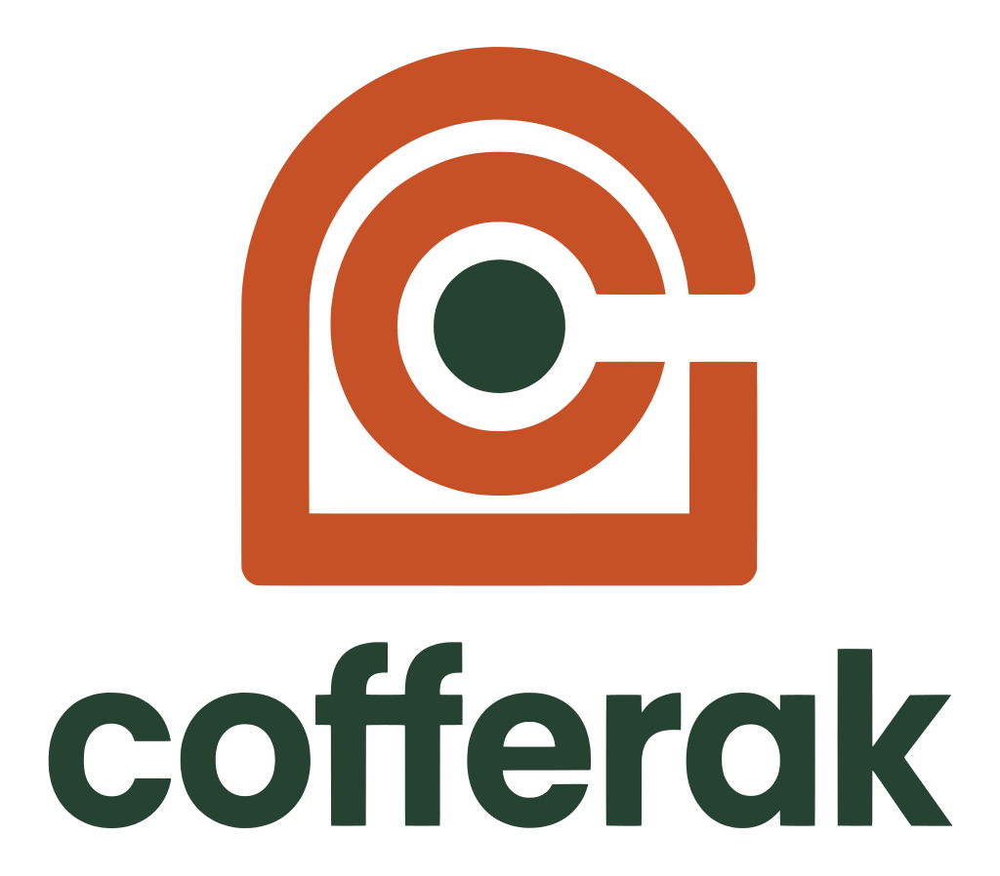
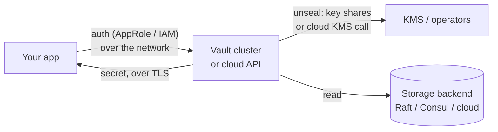
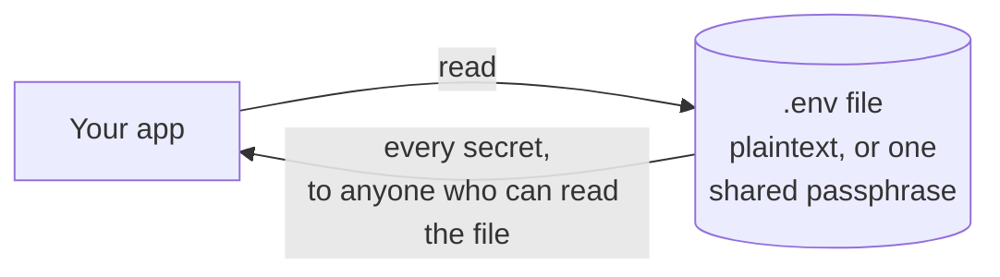
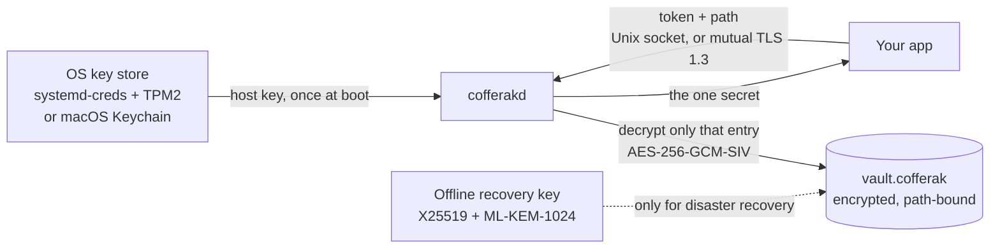

<p align="center">
  <picture>
    <source media="(prefers-color-scheme: dark)" srcset="docs/assets/cofferak-logo-dark.svg">
    
  </picture>
</p>

<p align="center">
  <strong>A military-grade, superfast coffer for your secrets and credentials.</strong><br>
  CNSA 2.0 algorithms · post-quantum recovery key · mutual TLS 1.3 · 0.24 µs decrypt · sub-millisecond reads<br>
  Self-hosted on Linux and macOS. No external server, cloud KMS or account.
</p>

<p align="center">
  <a href="https://github.com/arkrwn/cofferak/actions/workflows/ci.yml"></a>
  <a href="Cargo.toml"></a>
  <a href="LICENSE"></a>
  
  
  <a href="docs/adr/0011-cnsa-grade-crypto-and-hardened-transport.md"></a>
  <a href="docs/adr/0011-cnsa-grade-crypto-and-hardened-transport.md"></a>
  <a href="docs/benchmarks.md"></a>
  
</p>

<p align="center">
  <a href="#quickstart">Quickstart</a> ·
  <a href="#how-it-works-envelope-encryption-briefly">How it works</a> ·
  <a href="#server-mode">Server mode</a> ·
  <a href="docs/benchmarks.md">Benchmarks</a> ·
  <a href="#sdks">SDKs</a> ·
  <a href="docs/migration.md">Migration</a> ·
  <a href="docs/deployment.md">Deployment</a> ·
  <a href="docs/SPEC.md">Spec</a>
</p>

---

**cofferak** keeps application secrets (API keys, database passwords,
tokens) in a single encrypted file and serves them to your services
through a small daemon, `cofferakd`. The key that decrypts the vault is
sealed by the operating system itself — `systemd-creds` (with the TPM2
when present) on Linux, Keychain on macOS — so there is never a plaintext
master key on disk. Each service gets its own token, limited to the paths
and permissions you grant it.

By default `cofferakd` listens only on a local Unix socket. Turn on
**[server mode](#server-mode)** and it is also reachable over the
network through TLS 1.3 with mandatory mutual TLS, using the same
protocol and the same tokens.

### What "military-grade" and "superfast" mean here

Both claims are specific and checked on every commit:

- **Military-grade** = the NSA's CNSA 2.0 algorithms (the suite for
  protecting classified national-security systems) for everything that
  encrypts or exchanges keys: AES-256 for data, ML-KEM-1024 (FIPS 203,
  post-quantum; the only ML-KEM size CNSA 2.0 accepts) for the recovery
  key and as the preferred TLS key exchange, SHA-384 for key derivation
  and TLS. Certificates use ECDSA P-384 (CNSA 1.0) until TLS libraries
  support ML-DSA certificates. All of it runs on AWS-LC, a FIPS 140-3
  validated module. Details and test evidence:
  [ADR 0011](docs/adr/0011-cnsa-grade-crypto-and-hardened-transport.md).
- **Superfast** = decrypting a secret takes **0.24–0.26 µs**, large
  values stream at **1.4 GB/s (Apple M3 Pro) to 4.3 GB/s (x86-64 Linux
  CI runner)**, and a complete local read through the daemon has a
  **~83 µs** median latency on both. Reproduce with
  `./scripts/bench.sh`; CI runs it on every build. Full table:
  [docs/benchmarks.md](docs/benchmarks.md).

### Highlights

- **Envelope encryption** — one AES-256-GCM-SIV data key (DEK), wrapped
  per host and once for an offline recovery key; every ciphertext is
  bound to its path, so ciphertexts can't be swapped between secrets.
- **Post-quantum recovery key** — the recovery wrap uses X25519 *and*
  ML-KEM-1024 together, so a copy of the vault stolen today stays safe
  against a future quantum computer.
- **OS-sealed host keys** — the unseal key never sits next to the vault
  as a plain file; on Linux the daemon runs unprivileged and receives it
  from systemd.
- **Mandatory mutual TLS for remote access** — TLS 1.3 only, AES-256-GCM
  only, ML-KEM-1024 key exchange preferred, and no connection without a
  client certificate you issued.
- **Least-privilege tokens** — each service is scoped to path prefixes
  with read, write or read-write access.
- **Durable, crash-safe writes** — every acknowledged write is already on
  disk, written atomically under a lock.
- **Audit log** — every request, allowed or denied, is recorded.
- **Disaster recovery** — rebuild access on a new machine with the
  offline root key.
- **Easy migration** — import `.env` files, run apps without them, and
  move a whole vault to another machine or OS with one encrypted bundle.
- **Client SDKs** — Rust, Go, Python and TypeScript/JavaScript, each
  tested against a real daemon in CI over the Unix socket and mTLS.

> **Status: v0.1.0, pre-1.0.** Feature-complete and tested on every
> commit on Linux and macOS, including real systemd-creds sealing, a
> non-root systemd service, and TLS/mTLS for every SDK. The on-disk
> format and wire protocol may still change before 1.0. See
> [`docs/PROGRESS.md`](docs/PROGRESS.md) for what is proven and the
> known limitations.

## Why cofferak

Most secrets-management setups either hand you a server to operate
(HashiCorp Vault, a cloud KMS) or a flat file with one shared passphrase.
cofferak is neither: it's an **envelope-encryption** vault where the key
that decrypts your secrets is itself sealed by the operating system's own
secure-storage primitive — `systemd-creds` on Linux, Keychain on macOS —
so the unseal key is never a plaintext file sitting next to the vault.

How an application gets one secret, in each model:

**HashiCorp Vault / cloud secrets manager** — a separate service you run
(or rent), reached over the network, unsealed by key shares or a cloud
KMS:



**`.env` / encrypted file** — no server, but the secret (or the one
passphrase that opens every secret) sits next to the app:



**cofferak** — the vault lives on the same host; the OS unseals the key
once at boot; each app asks for only the paths its token allows:



| | Vault / cloud manager | `.env` file | cofferak |
|---|---|---|---|
| Something extra to operate | A cluster or a cloud account | Nothing | One small daemon per host |
| Where the unlock key lives | Key shares / external KMS | Next to the app (or no key) | Sealed by the OS (TPM2 / Keychain) |
| Network hop to read a secret | Yes | No | No (Unix socket); optional mTLS |
| Per-app least privilege | Yes (policies) | No | Yes (path-prefix tokens) |
| Post-quantum recovery path | Depends on setup | No | Yes (ML-KEM-1024 hybrid) |

- **No external dependency.** No third-party server to run, no account
  to create, no call out to any third-party KMS. `cofferakd` is the only
  server involved, and it's yours — local Unix socket by default, or
  your own mutual-TLS endpoint if you turn on server mode.
- **One codebase, two platforms.** `cofferak-core` (crypto, on-disk
  format, ACL) is entirely platform-agnostic; only the small `HostSeal`
  trait has a platform-specific implementation, so the same logic — and
  the same tests — run on both Linux and macOS.
- **Per-service, least-privilege access.** Consumers get a scoped
  capability token (path prefix + read/write), not a master key.

For an honest comparison with `.env` files, HashiCorp Vault, Infisical
and AWS Secrets Manager — including when one of those fits better — see
[`docs/comparison.md`](docs/comparison.md).

## How it works (envelope encryption, briefly)

- A **root keypair** (X25519 + ML-KEM-1024) is generated once. Its
  private half is printed once, as an armored block, for the operator to
  store off-machine; it is never kept on any host running the daemon.
- A random 256-bit **DEK** (Data Encryption Key) encrypts the secrets
  store (AES-256-GCM-SIV, each value bound to its path). It is never
  stored unwrapped: it's wrapped once per enrolled host (under that
  host's sealed unseal key) and once under the root public key with the
  hybrid post-quantum KEM (for disaster recovery).
- Each enrolled **host** has its own random unseal key, sealed by the
  platform's `HostSeal` backend so it is only recoverable on that
  specific host, inside the daemon process.
- Each enrolled **service** gets an access token scoped to a set of path
  prefixes and a permission level (read / write / read-write) — never
  the DEK itself.

See [`docs/SPEC.md`](docs/SPEC.md) for the full design, including the
on-disk format, the daemon's request protocol, and the disaster-recovery
flow, and [`docs/adr/`](docs/adr/) for the point decisions behind it.

## Server mode

By default `cofferakd` only listens on a local Unix socket — the fastest
and smallest-attack-surface option when every client is on the same
host. **Server mode** is the opt-in path for when a client genuinely
isn't: set `$COFFERAK_TLS_ADDR` (e.g. `0.0.0.0:8443`) and the daemon also
listens on TLS-wrapped TCP, serving the *exact same* `Request`/`Response`
protocol and the *exact same* per-service access tokens — not a second
API to learn, not a second thing to keep in sync. See
[ADR 0008](docs/adr/0008-server-mode-rpc-over-tls.md) for why this (RPC
over TLS) was chosen over REST or WebSocket.

Don't have certificates yet? One command makes a private P-384 CA, a
server certificate and client certificates:

```bash
./scripts/gen-certs.sh ./tls cofferak.internal app1 app2
```

```bash
# Server side: turn on TLS alongside the existing Unix socket. All four
# TLS variables are required: mutual TLS is mandatory.
COFFERAK_DATA_DIR=./data \
COFFERAK_TLS_ADDR=0.0.0.0:8443 \
COFFERAK_TLS_CERT=./tls/server.pem \
COFFERAK_TLS_KEY=./tls/server.key \
COFFERAK_TLS_CLIENT_CA=./tls/ca.pem \
  cofferak daemon     # cofferakd on a Linux systemd install
```

| Variable | Purpose |
|---|---|
| `COFFERAK_TLS_ADDR` | `host:port` to listen on. Unset = server mode is off (Unix socket only). |
| `COFFERAK_TLS_CERT` / `COFFERAK_TLS_KEY` | Server certificate + private key (PEM). Required once `COFFERAK_TLS_ADDR` is set. |
| `COFFERAK_TLS_CLIENT_CA` | **Required.** CA (PEM) that signs every client certificate. The daemon refuses to start server mode without it. |
| `COFFERAK_TLS_MAX_CONNECTIONS` | Optional. Maximum concurrent TLS connections (default `256`); connections beyond it are closed immediately. |

The transport is locked to the strongest settings every SDK supports
([ADR 0011](docs/adr/0011-cnsa-grade-crypto-and-hardened-transport.md)):

- **TLS 1.3 only** — the newest TLS version; 1.2 and older are refused.
- **One cipher suite:** `TLS_AES_256_GCM_SHA384`. AES-128 is refused.
- **Key exchange:** post-quantum `ML-KEM-1024` first (CNSA 2.0), then
  the `X25519MLKEM768` hybrid that Go and newer OpenSSL clients offer,
  then classical `P-384` for TLS libraries with no post-quantum support
  yet.
- **Mutual TLS, always:** no client certificate from your CA, no
  connection. The per-service token is still checked on every request.
- Bounded request/response lines, a 30-second per-connection timeout,
  and a concurrent-connection cap. There is no per-client rate limit
  yet; for an internet-facing deployment keep a firewall or a
  per-IP-limiting proxy in front.

All four SDKs support this transport: Rust (`rustls` + AWS-LC), Go
(`crypto/tls`), Python (`ssl`), TypeScript/JavaScript (`node:tls`); see
each SDK's page under [`docs/sample-integration/`](docs/sample-integration/).
Every claim above is tested on every commit by:

```bash
./scripts/server-mode-smoke.sh
```

It proves that server mode won't start without a client CA; that every
SDK is rejected without a client certificate, with one from an untrusted
CA, or with the wrong hostname; that TLS 1.2 and AES-128 clients are
refused; and that the Rust SDK negotiates
`TLSv1_3 TLS13_AES_256_GCM_SHA384 MLKEM1024`.

## Repository layout

```
cofferak/
  cofferak-core/   # lib: crypto, on-disk format, ACL, HostSeal — no process I/O beyond disk reads/writes
  cofferakd/       # daemon: Unix socket + TLS server mode, platform seal integration, audit log
  cofferak-cli/    # admin CLI: init/enroll-host/enroll-service/set/get/rm/list/rotate-dek/recover/audit tail
  sdk/             # client SDKs: rust, go, python, javascript (TypeScript)
  deployment/      # copy-and-edit systemd unit (Linux) and launchd plist (macOS)
  scripts/         # quickstart-check, sdk-smoke, server-mode-smoke, bench, gen-certs
  docs/            # SPEC.md, adr/, PROGRESS.md, deployment guide, recovery runbook,
                   # sample-integration/, assets/ (logo and icons)
  SDD.md           # the design/documentation practice this repo follows
```

## What's implemented

- **Envelope crypto** (`cofferak-core::crypto`, on AWS-LC):
  hardware-accelerated AES-256-GCM-SIV for entries, tokens and per-host
  DEK wraps, each bound to its context; a hybrid X25519 + ML-KEM-1024
  recovery wrap with HKDF-SHA-384; an armored, checksummed root private
  key; zeroize-on-drop key handling.
- **On-disk format** (`cofferak-core::format`): the `vault.cofferak` binary
  file and its `meta.json` sidecar, with corrupt/truncated input returned
  as a typed error rather than a panic or a silently fresh vault.
- **Path-prefix ACL** (`cofferak-core::acl`): per-service access tokens
  scoped to path prefixes and a permission level, with a traversal-safe
  prefix check.
- **`HostSeal` trait + both backends** (`cofferak-core::seal`): the one
  platform-dependent abstraction, with:
  - `SystemdCredsSeal` (Linux) — shells out to the real `systemd-creds`
    binary.
  - `KeychainSeal` (macOS) — stores/retrieves the key as a generic
    password in the Keychain via `security-framework`.

  Both map failures to the same `SealError::{Unavailable, Invalid, Io}`
  taxonomy, so callers (and tests) don't need to care which platform
  they're on.
- **`cofferakd`**: the daemon. Loads `vault.cofferak`, unseals its own host
  key, opens the append-only audit log, then serves `Get`/`Set`/`Rm`/`List`
  requests from service tokens over a Unix socket (newline-delimited
  JSON) and, in [server mode](#server-mode), TLS/TCP too — the same
  protocol, same tokens, same `Daemon::handle_request` either way.
  Reads `COFFERAK_DATA_DIR` and `COFFERAK_SOCKET` at startup (falling back
  to a per-OS default — see [`docs/deployment.md`](docs/deployment.md)),
  and refuses to start rather than silently creating an empty vault if
  `vault.cofferak` or the sealed host key is missing or unreadable.
- **Server mode** (`cofferakd::tls_server`): opt-in TLS/TCP listener
  alongside the Unix socket (`rustls` on AWS-LC): TLS 1.3 only,
  `TLS_AES_256_GCM_SHA384` only, ML-KEM-1024 key exchange preferred, and
  mandatory mutual TLS. See [Server mode](#server-mode), ADR
  [0008](docs/adr/0008-server-mode-rpc-over-tls.md) and
  [0011](docs/adr/0011-cnsa-grade-crypto-and-hardened-transport.md).
- **`cofferak-cli`** (binary name `cofferak`): the admin CLI (see
  [Commands](#commands) below) —
  vault/host bootstrap, service enrollment, `set`/`get`/`rm`/`list` over
  the daemon socket, DEK rotation, disaster recovery, and audit log
  inspection.
- **Deployment templates** (`deployment/`): a systemd unit for Linux and a
  launchd plist for macOS, documented end to end in
  [`docs/deployment.md`](docs/deployment.md).
- **Audit log** (`cofferakd::audit`): an append-only JSON-lines log of
  every service request (`<ts> <service_id> <action> <path> <result>`),
  readable offline via `cofferak audit tail`.

## Quickstart

Try it locally in about five minutes. You need Rust 1.89 or newer
([rustup.rs](https://rustup.rs)); macOS or Linux with systemd.

**1. Build and point your shell at a throwaway vault**

```bash
git clone https://github.com/arkrwn/cofferak && cd cofferak
cargo build --release
export PATH="$PWD/target/release:$PATH"
export COFFERAK_DATA_DIR="$HOME/.cofferak-demo"
export COFFERAK_SOCKET="$COFFERAK_DATA_DIR/cofferakd.sock"
mkdir -p "$COFFERAK_DATA_DIR" && chmod 700 "$COFFERAK_DATA_DIR"
```

**2. Create the vault and enroll this machine**

```bash
ADMIN=cofferak                                    # macOS
ADMIN="sudo env COFFERAK_DATA_DIR=$COFFERAK_DATA_DIR $(command -v cofferak)"   # Linux: sealing needs root

$ADMIN init --root            # prints the root private key ONCE: save the whole
                              # -----BEGIN/END----- block offline (it's your recovery key)
$ADMIN init --host demo       # seals this machine's key (Keychain / systemd-creds)
$ADMIN enroll-service myapp --paths myapp --perm rw
                              # prints myapp's access token ONCE
```

**3. Start the daemon** (in a second terminal, with the same `export`s)

```bash
# macOS
cofferak daemon

# Linux: run it the way production does, as you (not root), with systemd
# handing it the host key (copy as-is):
sudo systemd-run --unit=cofferak-demo --uid="$(id -u)" --gid="$(id -g)" \
  -p "LoadCredentialEncrypted=cofferak-demo:$COFFERAK_DATA_DIR/hosts/demo.seal" \
  --setenv=COFFERAK_DATA_DIR="$COFFERAK_DATA_DIR" --setenv=COFFERAK_SOCKET="$COFFERAK_SOCKET" \
  --setenv=COFFERAK_HOST_ID=demo "$(command -v cofferak)" daemon
```

**4. Store and read secrets**

```bash
export COFFERAK_TOKEN=<token printed by enroll-service>   # this shell only

# Type a secret without it touching the screen, argv or shell history:
read -rs -p "DB password: " V && printf %s "$V" | cofferak set myapp/DB_PASSWORD --stdin; unset V
cofferak get myapp/DB_PASSWORD

# Store a whole file, byte for byte (an SSH key, a certificate, a JSON credential):
cofferak set myapp/ssh/id_ed25519 --from-file ~/.ssh/id_ed25519
cofferak get myapp/ssh/id_ed25519 | ssh-add -      # load it into ssh-agent
cofferak list myapp
cofferak get other/thing                           # denied: outside myapp's paths
```

**5. Replace your `.env` file**

```bash
cofferak import-env .env --prefix myapp/env       # parses quotes, export, comments, multi-line values
cofferak run --prefix myapp/env -- ./your-app      # app gets the variables; no file on disk
rm .env
```

or read secrets in code with an [SDK](#sdks). To clean up: stop the daemon
(Ctrl-C, or `sudo systemctl stop cofferak-demo` on Linux) and
`rm -rf ~/.cofferak-demo`; on macOS also
`security delete-generic-password -s cofferak -a demo`.

A step-by-step walkthrough of every command, the SDKs and the failure
cases is in [docs/getting-started.md](docs/getting-started.md). For a
permanent install (systemd unit, launchd agent) see
[docs/deployment.md](docs/deployment.md).

## Commands

All `cofferak-cli` subcommands accept `--data-dir <DIR>` (or
`$COFFERAK_DATA_DIR`), defaulting to the platform data directory
(`/var/lib/cofferak` on Linux, `~/Library/Application Support/cofferak`
on macOS). `set`/`get`/`rm`/`list` additionally accept `--socket <PATH>`
(or `$COFFERAK_SOCKET`) and a service token via `--token` (or
`$COFFERAK_TOKEN`).

| Command | Purpose |
|---------|---------|
| `init --root` | Create a brand-new vault and a hybrid root keypair (X25519 + ML-KEM-1024). Prints the root private key once, as an armored block. |
| `init --host <id>` | Enroll the *first* host into a vault created by `init --root`. |
| `enroll-host <new-id> --this-host <id>` | Enroll an *additional* host, using an already-enrolled host's own sealed key to recover the DEK. |
| `enroll-service <id> --paths <csv> --perm <ro\|rw>` | Enroll a consuming service and print its one-time access token. |
| `set <path> --stdin` / `--from-file <f>` / `<value>` | Write a secret (over the daemon socket). `--stdin` and `--from-file` keep the value out of argv and shell history; use them for real secrets. |
| `get <path> [-o <file>]` | Read a secret (over the daemon socket); `-o` writes the exact bytes to a `0600` file. |
| `rm <path> --token <t>` | Remove a secret (over the daemon socket). |
| `list [prefix] --token <t>` | List secret paths under a prefix (over the daemon socket). |
| `rotate-dek --hosts <csv>` | Generate a fresh DEK, re-encrypt every entry/token, and re-wrap it for the root key and the given hosts. Operates on `vault.cofferak` directly, not over the socket. Restart `cofferakd` afterwards: until then it refuses writes rather than using the stale DEK. |
| `recover --root-key <path> --new-host <id>` | Disaster recovery: enroll a new host using the offline root private key (the saved armored block), bypassing every enrolled host's own sealed blob. See [`docs/recovery-runbook.md`](docs/recovery-runbook.md). |
| `audit tail [--count N]` | Print the last `N` (default 20) entries of the daemon's audit log, read directly from `<data_dir>/audit.jsonl`. |
| `daemon` | Run the daemon in the foreground (same code as `cofferakd`). Use this on macOS; see [deployment](docs/deployment.md#macos-launchd). |
| `import-env <file\|-> --prefix <p>` | Import a `.env` file (each `KEY=value` → `<p>/KEY`); `--dry-run`, `--overwrite`. |
| `export-env --prefix <p> -o <file\|->` | Write the variables under `<p>` as a `.env` file (mode 0600). |
| `run --prefix <p> [--prefix <q>] -- <cmd>` | Run a command with those secrets as environment variables; nothing written to disk. |
| `export -o <file>` | Whole vault (secrets + service tokens) as a passphrase-encrypted bundle, for backup or moving to another machine/OS. |
| `import <file>` | Restore a bundle into this vault; `--dry-run`, `--overwrite`. Apps keep their tokens. |

`cofferakd` itself takes no CLI flags; it reads `COFFERAK_DATA_DIR` and
`COFFERAK_SOCKET` from the environment (same per-OS defaults as above),
`COFFERAK_HOST_ID` to pick which enrolled host's sealed key to use when the
vault has more than one (unneeded, and inferred automatically, when
there's exactly one), and `COFFERAK_TLS_*` to turn on [server
mode](#server-mode). See [`docs/deployment.md`](docs/deployment.md) for
running it as a systemd service (Linux) or a launchd agent (macOS),
including the `systemd-creds`/Keychain host-key sealing steps and socket
permissions.

## Import, export and migrate

cofferak has no database to migrate: the whole vault is one file. Moving
secrets is a few commands ([docs/migration.md](docs/migration.md)):

```bash
cofferak import-env .env --prefix myapp/env            # from a .env file
cofferak export-env --prefix myapp/env -o app.env      # back to a .env file

cofferak export -o backup.cfk                          # old machine: encrypted bundle, passphrase-protected
cofferak import backup.cfk                             # new machine (any OS): secrets and app tokens restored
                                                       # (export/import are admin commands: on Linux use $ADMIN)

vault kv get -format=json secret/myapp \
  | jq -r '.data.data | to_entries[] | "\(.key)=\(.value | @json)"' \
  | cofferak import-env - --prefix myapp/env           # from HashiCorp Vault KV
```

Bundles are AES-256-GCM-SIV encrypted with a PBKDF2-HMAC-SHA384 key from
your passphrase, hold no machine-specific keys, and work between Linux
and macOS. A running daemon picks up imports and newly enrolled services
immediately, with no restart ([ADR 0012](docs/adr/0012-import-export-and-live-reload.md)).

## SDKs

A consuming service talks to `cofferakd` over its Unix socket — or, in
[server mode](#server-mode), TLS/mTLS over TCP — using the
newline-delimited JSON protocol in [`docs/SPEC.md`](docs/SPEC.md) §6.
Four client SDKs implement it today, **all four over both transports**
— each is smoke-tested for real against a running daemon in CI
(`scripts/sdk-smoke.sh` for the Unix socket, `scripts/server-mode-smoke.sh`
for TLS/mTLS including adversarial reject cases, both wired into
`.github/workflows/ci.yml`), not just documented:

| Language | Package | TLS library | Example |
|---|---|---|---|
| Rust | [`sdk/rust/cofferak-sdk`](sdk/rust/cofferak-sdk) | `rustls` | [`docs/sample-integration/rust.md`](docs/sample-integration/rust.md) |
| Go | [`sdk/go/cofferak`](sdk/go/cofferak) | `crypto/tls` (stdlib) | [`docs/sample-integration/go.md`](docs/sample-integration/go.md) |
| Python | [`sdk/python/cofferak_sdk`](sdk/python/cofferak_sdk) | `ssl` (stdlib) | [`docs/sample-integration/python.md`](docs/sample-integration/python.md) |
| TypeScript | [`sdk/javascript/cofferak-sdk`](sdk/javascript/cofferak-sdk) | `node:tls` (stdlib) | [`docs/sample-integration/typescript.md`](docs/sample-integration/typescript.md) |
| JavaScript | same package, compiled `dist/` | `node:tls` (stdlib) | [`docs/sample-integration/javascript.md`](docs/sample-integration/javascript.md) |

The Go, Python and Node SDKs use only their language's standard library;
the Rust SDK uses `rustls` on AWS-LC, the same stack as the daemon.
Copy-paste samples for all four, verified against a running daemon, are
in [docs/getting-started.md](docs/getting-started.md#6-read-secrets-from-code-sdks).

```python
# Python, the shortest example — same shape in every SDK above.
from cofferak_sdk import Client

client = Client("/run/cofferak/cofferakd.sock")
client.set("<token>", "myapp/DB_PASSWORD", b"s3cr3t")
value = client.get("<token>", "myapp/DB_PASSWORD")
```

None of these are published to a package registry yet — consume them via
a local path/relative reference (see each SDK's own page above) until
the wire protocol and SDK surface area are stable enough to commit to.
Planned next: C, C++, Perl, Ruby — see
[`docs/sample-integration/roadmap.md`](docs/sample-integration/roadmap.md).

## Building and testing

```bash
cargo build --workspace
cargo test --workspace
```

`cofferak-core`'s test suite includes real integration tests against the
platform's actual sealing facility — `tests/seal_linux.rs` (skips with a
clear message if `systemd-creds` isn't on `PATH`, e.g. off Linux) and
`tests/seal_macos.rs` (runs for real against a uniquely-named,
test-scoped Keychain item on macOS, and cleans it up afterward).

End-to-end scripts (all run in CI on Linux and macOS):

```bash
./scripts/quickstart-check.sh     # the Quickstart above, run as written
./scripts/sdk-smoke.sh            # real CLI + daemon + sealing, all four SDKs, restart durability
./scripts/server-mode-smoke.sh    # mutual TLS accept/reject in all four SDKs, downgrade refusals
./scripts/bench.sh                # performance numbers (docs/benchmarks.md)
./scripts/gen-certs.sh DIR NAME [CLIENT...]   # helper: P-384 CA, server and client certs
```

## Further reading

- [`docs/comparison.md`](docs/comparison.md) — how cofferak compares to
  `.env` files, HashiCorp Vault, Infisical, and AWS Secrets Manager,
  and honestly, when one of those is the better fit instead.
- [`docs/deployment.md`](docs/deployment.md) — running `cofferakd` as a
  systemd service or launchd agent, environment variables, socket
  permissions.
- [`docs/key-security.md`](docs/key-security.md) — how to actually
  secure the root private key `init --root` prints once: offline
  storage options, custody splitting, what never to do with it, and
  periodic recovery drills.
- [`docs/recovery-runbook.md`](docs/recovery-runbook.md) — disaster
  recovery with the offline root private key, for an operator who has
  never seen this project before.
- [`docs/sample-integration/`](docs/sample-integration/) — worked, CI-run
  examples: CLI/shell, and the Rust/Go/Python/TypeScript/JavaScript SDKs
  below.
- [`docs/SPEC.md`](docs/SPEC.md) — full design: on-disk format, the
  daemon's request protocol, and the disaster-recovery flow.
- [`docs/adr/`](docs/adr/) — numbered point decisions (why envelope
  encryption, why no external vault/KMS dependency, why the `HostSeal`
  abstraction, why `cofferakd` has a library target, why server mode is
  RPC-over-TLS rather than REST/WebSocket, how the Linux daemon gets its
  key without root, and why writes are durable before they are
  acknowledged).
- [`docs/PROGRESS.md`](docs/PROGRESS.md) — implementation status, one row
  per area, each backed by what was actually run.
- [`SDD.md`](SDD.md) — the design/documentation practice this project
  follows; read it before making an architectural change.
- [`docs/assets/`](docs/assets/) — logo, icons (SVG, PNG, ICO) and brand
  colours.

## Contributing

See [CONTRIBUTING.md](CONTRIBUTING.md). Contributions require accepting
the project's CLA ([CLA.md](CLA.md)) on your first pull request.

## License

Apache License 2.0 — see [LICENSE](LICENSE) and [NOTICE](NOTICE). The
`cofferak` name and logo are governed separately by the
[trademark policy](TRADEMARK.md): the license covers the code, not the
name.
