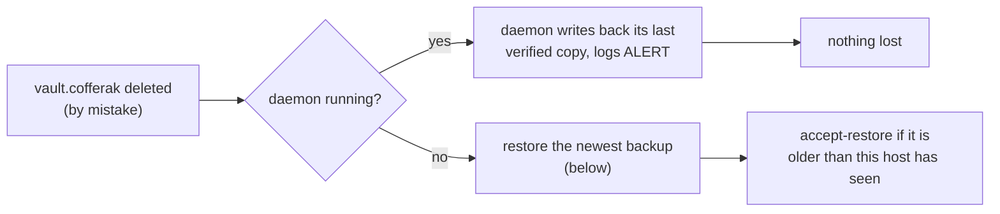

# Backup, health checks and restore

`vault.cofferak` is a single file, so protect it like any important file:
keep copies elsewhere, and get told when something is wrong. cofferak
helps with all three.

## What happens if the vault file is deleted



- **The daemon is running:** it notices on the next request (or the next
  write) and writes back the newest copy it verified, so nothing is lost.
  It logs `cofferakd: ALERT: ... was deleted, restored it ...`. Stop the
  daemon first if you ever remove a vault on purpose.
- **The daemon is stopped:** restore from a backup.

The vault is encrypted, so a deleted or stolen file never exposes secrets.
What a deletion can cost you is availability, which is what backups fix.

## Backups

```bash
cofferak backup --dir /var/backups/cofferak --keep 30
```

- Copies `vault.cofferak` into the directory as
  `cofferak-vault-<UTC time>.cofferak` (mode 0600), after checking that it
  decodes, and deletes the oldest copies beyond `--keep`. Other files in
  the directory are never touched.
- The copy is still encrypted with the vault's key. Making it needs no key,
  so it runs unattended: on Linux as the unprivileged `cofferak` user, on
  macOS without a Touch ID prompt.
- To restore it you need either this host (its sealed key) or the offline
  root key. Without one of those a backup is useless to anyone, including
  a thief.

Portable bundles, for moving to another machine without the root key:

```bash
cofferak backup --dir ~/Backups/cofferak --passphrase-file ~/.cofferak-backup-pass
cofferak backup --dir /mnt/backup --to server      # only the paired coffer "server" can open it
```

These need this host's key (an admin command: root on Linux, Touch ID on
macOS), so they suit manual runs better than timers.

### Schedule it

Linux (systemd), daily, keeping 30 copies, with a health check after each
run:

```bash
sudo install -d -m 0700 -o cofferak -g cofferak /var/backups/cofferak
sudo cp deployment/linux/cofferak-backup.service deployment/linux/cofferak-backup.timer /etc/systemd/system/
sudo systemctl daemon-reload && sudo systemctl enable --now cofferak-backup.timer
systemctl list-timers cofferak-backup.timer
```

macOS (launchd), daily at 03:15:

```bash
cp deployment/macos/com.cofferak.backup.plist ~/Library/LaunchAgents/
# replace REPLACE_WITH_USER in the file, then:
launchctl bootstrap gui/$(id -u) ~/Library/LaunchAgents/com.cofferak.backup.plist
```

Keep the backup directory on another disk, or sync it off the machine.
On Linux, don't back up `/var/lib/cofferak-anchor` together with the
data: that keeps rollback detection working after a restore (ADR 0017).

## Health check

```bash
cofferak doctor --backup-dir /var/backups/cofferak
```

```
ok   data directory /var/lib/cofferak (mode 700)
ok   vault: format 4, generation 42, 12 secrets, 3 services, 1 hosts, integrity code present
ok   host web1: sealed key and anchor present
ok   daemon is listening on /run/cofferak/cofferakd.sock
ok   newest backup /var/backups/cofferak/cofferak-vault-20261111T031500Z.cofferak is 7 hours old (30 backups kept)
```

Exit code `0` means healthy, `1` warnings (for example no recent backup,
or the daemon is not running), `2` a problem (for example the vault file
is missing or damaged). Wire it into your monitoring, or let the systemd
backup unit run it after each backup, so a failure shows up in
`systemctl --failed`.

## Restore

**Same host** (it is still enrolled, for example after deleting the file
with the daemon stopped):

```bash
sudo systemctl stop cofferakd                       # macOS: stop `cofferak daemon`
cp /var/backups/cofferak/cofferak-vault-<newest>.cofferak /var/lib/cofferak/vault.cofferak
sudo chown cofferak:cofferak /var/lib/cofferak/vault.cofferak && sudo chmod 600 /var/lib/cofferak/vault.cofferak
sudo cofferak accept-restore                        # only if it says the copy is older
sudo systemctl start cofferakd
```

If the backup is older than the newest state this host saw, the daemon
refuses it until you run `accept-restore`. That is rollback protection
(ADR 0015) working as intended: changes made after that backup are gone,
and cofferak makes you confirm it.

**Another machine** (the original is lost): copy the backup into the new
machine's data directory and enroll it with the offline root key, see the
[recovery runbook](recovery-runbook.md). For a passphrase or peer bundle,
create a fresh vault there and `cofferak import <bundle> --with-tokens`
([migration.md](migration.md)).
