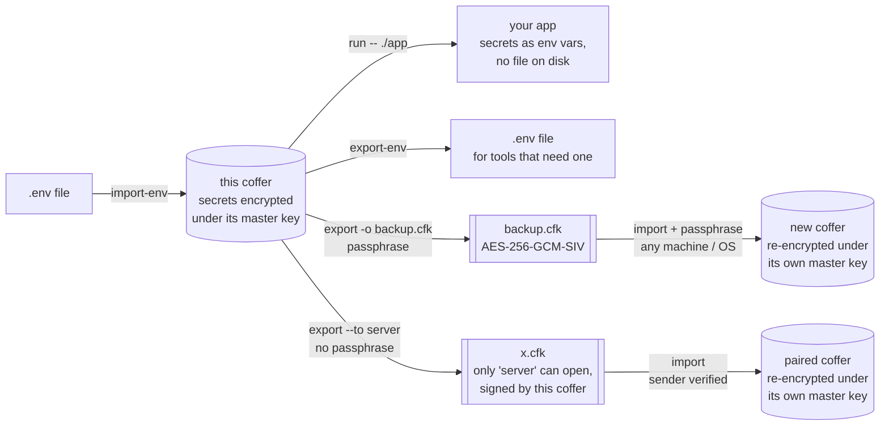

# Command reference

All `cofferak-cli` subcommands accept `--data-dir <DIR>` (or
`$COFFERAK_DATA_DIR`), defaulting to the platform data directory
(`/var/lib/cofferak` on Linux, `~/Library/Application Support/cofferak`
on macOS). `set`/`get`/`rm`/`list` additionally accept `--socket <PATH>`
(or `$COFFERAK_SOCKET`) and take the service token from `$COFFERAK_TOKEN`
or `--token-file FILE`. A token on the command line is refused, since
other users could read it with `ps`.

| Command | Purpose |
|---------|---------|
| `init --root` | Create a brand-new vault and a hybrid root keypair (X25519 + ML-KEM-1024). Prints the root private key once, as an armored block. |
| `init --host <id>` | Enroll the *first* host into a vault created by `init --root`. |
| `enroll-host <new-id> --this-host <id>` | Enroll an *additional* host, using an already-enrolled host's own sealed key to recover the DEK. |
| `enroll-service <id> --paths <csv> --perm <ro\|rw>` | Enroll a consuming service and print its one-time access token. |
| `set <path> --stdin` / `--from-file <f>` / `<value>` | Write a secret (over the daemon socket). `--stdin` and `--from-file` keep the value out of argv and shell history, use them for real secrets. |
| `get <path> [-o <file>]` | Read a secret (over the daemon socket); `-o` writes the exact bytes to a `0600` file. |
| `rm <path>` | Remove a secret (over the daemon socket). |
| `list [prefix]` | List secret paths under a prefix (over the daemon socket). |
| `rotate-dek --hosts <csv>` | Generate a fresh DEK, re-encrypt every entry/token, and re-wrap it for the root key and the given hosts. Operates on `vault.cofferak` directly, not over the socket. Restart `cofferakd` afterwards: until then it refuses writes rather than using the stale DEK. |
| `recover --root-key <path> --new-host <id>` | Disaster recovery: enroll a new host using the offline root private key (the saved armored block), bypassing every enrolled host's own sealed blob. See [`docs/recovery-runbook.md`](recovery-runbook.md). |
| `backup --dir <d> [--keep N]` | Copy the encrypted vault into `<d>` and keep the newest N copies. No key needed, so it runs from a timer. See [backup.md](backup.md). |
| `doctor [--backup-dir <d>]` | Health check: vault, this host, daemon, backups. Exit code 0 ok, 1 warnings, 2 problem. |
| `accept-restore` | After restoring an older backup on purpose, accept it (rollback protection otherwise refuses it). |
| `audit tail [--count N]` | Print the last `N` (default 20) entries of the daemon's audit log, read directly from `<data_dir>/audit.jsonl`. |
| `daemon` | Run the daemon in the foreground (same code as `cofferakd`). Use this on macOS, see [deployment](deployment.md#macos-launchd). |
| `import-env <file\|-> --prefix <p>` | Import a `.env` file (each `KEY=value` → `<p>/KEY`); `--dry-run`, `--overwrite`. |
| `export-env --prefix <p> -o <file\|->` | Write the variables under `<p>` as a `.env` file (mode 0600). |
| `run --prefix <p> [--prefix <q>] -- <cmd>` | Run a command with those secrets as environment variables, nothing written to disk. |
| `export -o <file> [--to <peer>] [--prefix <p>]` | Secrets (and service tokens) as a bundle: passphrase-encrypted, or with `--to` encrypted for a paired coffer and signed by this one. `--prefix` selects part of the vault. |
| `import <file>` | Restore a passphrase bundle or a peer transfer (sender verified) into this vault; `--dry-run`, `--overwrite`, `--from <identity file>`. |
| `identity [-o <file>]` | Print this coffer's public identity, to pair with another coffer. |
| `peer add <name> <file>` / `peer list` / `peer rm <name>` | Manage the coffers this one trusts for transfers. |

`cofferakd` itself takes no CLI flags, it reads `COFFERAK_DATA_DIR` and
`COFFERAK_SOCKET` from the environment (same per-OS defaults as above),
`COFFERAK_HOST_ID` to pick which enrolled host's sealed key to use when the
vault has more than one (unneeded, and inferred automatically, when
there's exactly one), and `COFFERAK_TLS_*` to turn on [server
mode](server-mode.md). See [`docs/deployment.md`](deployment.md) for
running it as a systemd service (Linux) or a launchd agent (macOS),
including the `systemd-creds`/Keychain host-key sealing steps and socket
permissions.

## Import, export and migrate

cofferak has no database to migrate: the whole vault is one file. Moving
secrets is a few commands ([docs/migration.md](migration.md), with
step-by-step diagrams):



```bash
cofferak import-env .env --prefix myapp/env            # from a .env file
cofferak export-env --prefix myapp/env -o app.env      # back to a .env file

cofferak export -o backup.cfk                          # old machine: encrypted bundle, passphrase-protected
cofferak import backup.cfk --with-tokens               # new machine (any OS): secrets and app tokens restored

cofferak export --to server --prefix myapp -o x.cfk    # between paired coffers: no passphrase, only the
cofferak import x.cfk                                  # server can open it, and it verifies who sent it
                                                       # (export/import/peer are admin commands: on Linux use $ADMIN)

vault kv get -format=json secret/myapp \
  | jq -r '.data.data | to_entries[] | "\(.key)=\(.value | @json)"' \
  | cofferak import-env - --prefix myapp/env           # from HashiCorp Vault KV
```

Passphrase bundles are AES-256-GCM-SIV encrypted under a
PBKDF2-HMAC-SHA384 key. Transfers between paired coffers (`cofferak
identity`, `cofferak peer add`) are encrypted to the receiving coffer
with X25519 + ML-KEM-1024 and signed with ECDSA P-384 + ML-DSA-87, the
receiver re-encrypts everything under its own master key, so each coffer
keeps exactly one. Neither kind holds machine-specific keys, both work
between Linux and macOS, and a running daemon picks up imports
immediately ([ADR 0012](adr/0012-import-export-and-live-reload.md),
[ADR 0013](adr/0013-coffer-identities-and-peer-transfers.md)).

## Backups and health

```bash
cofferak backup --dir /var/backups/cofferak --keep 30    # encrypted copy, no key needed
cofferak doctor --backup-dir /var/backups/cofferak       # exit 0 ok, 1 warnings, 2 problem
```

If the vault file is deleted while the daemon runs, the daemon writes back
its last verified copy and logs an alert. Daily timer templates for systemd
and launchd, and restore steps, are in [docs/backup.md](backup.md).
