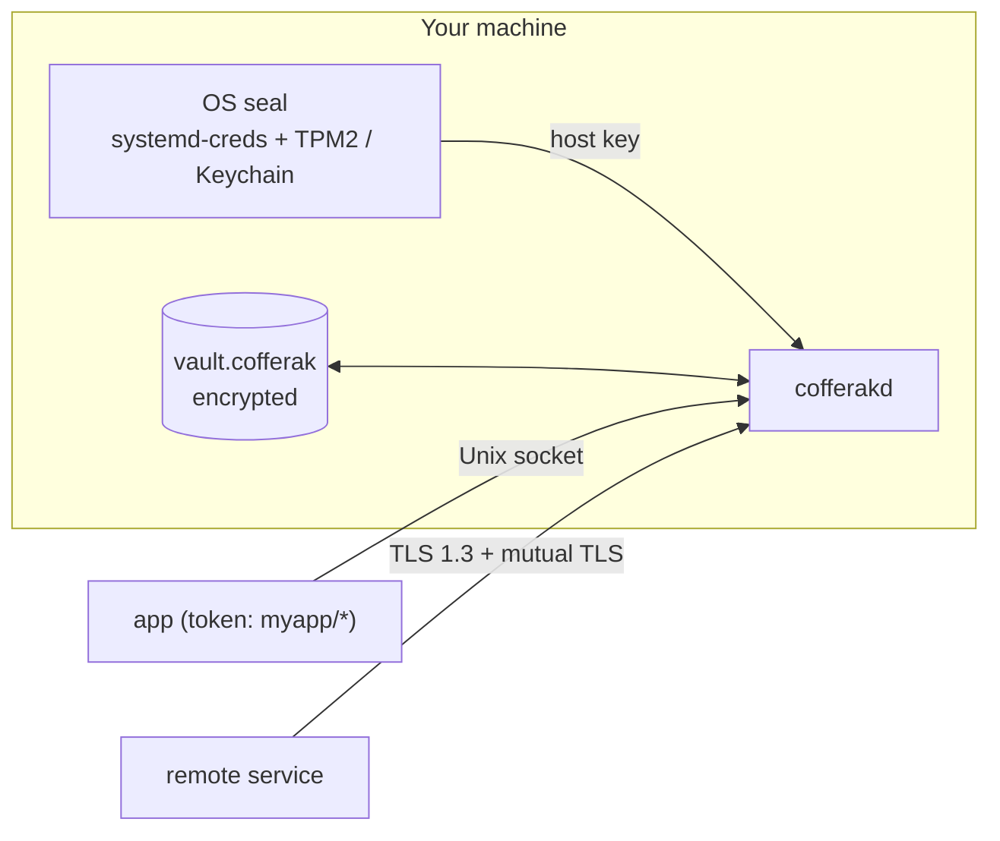

---
hide:
  - navigation
  - toc
---

**A military-grade, superfast coffer for your secrets and credentials.**

Self-hosted on Linux and macOS. No external server, cloud KMS or account.

[Get started](getting-started.md){ .md-button .md-button--primary }
[How it works](overview.md){ .md-button }

cofferak keeps application secrets (API keys, database passwords, tokens,
SSH keys) in one encrypted file and serves them to your services through a
small daemon. The key that opens the vault is sealed by the operating
system, so there is never a plaintext master key on disk. Each service gets
its own token, limited to the paths and permissions you grant it.

-   **Strong crypto**

    CNSA 2.0 algorithms, a post-quantum recovery key, TLS 1.3 with
    mandatory mutual TLS. [Overview](overview.md)

-   **Fast**

    Reads in well under a millisecond, 0.24 µs to decrypt a value.
    [Benchmarks](benchmarks.md)

-   **Hard to misuse**

    Edits and rollbacks of the vault are detected, tokens never go on the
    command line, admin commands on macOS need Touch ID.
    [Security](key-security.md)

-   **Easy to adopt**

    Import a `.env` file, run your app with `cofferak run`, or use an SDK.
    [Migration](migration.md) · [SDKs](sdks.md)

-   **Safe to operate**

    Encrypted backups with retention, a health check, and a daemon that
    puts back a deleted vault. [Backup](backup.md)

-   **Designed in the open**

    A full specification and one decision record per design choice.
    [Spec](SPEC.md) · [ADRs](adr/README.md)

