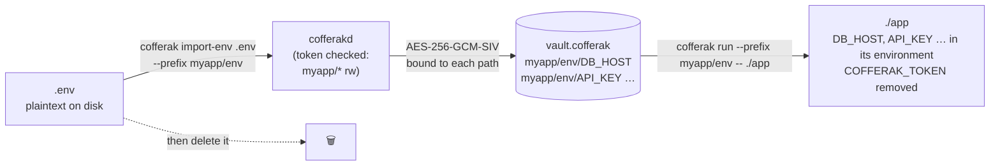
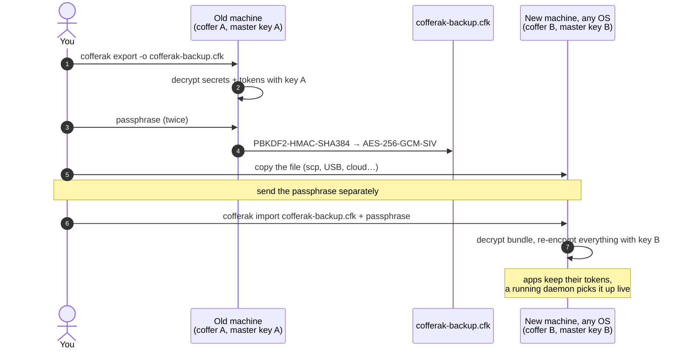
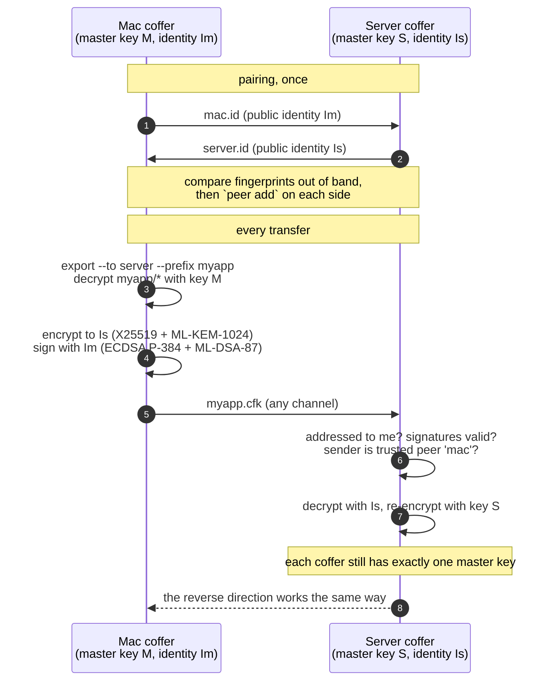

# Importing, exporting and migrating

cofferak has no database: everything lives in one file, `vault.cofferak`
(plus the optional `audit.jsonl` log). Moving secrets in, out, or to
another machine is done with five commands:

| Goal | Command |
|---|---|
| Bring a `.env` file in | `cofferak import-env .env --prefix myapp/env` |
| Run an app with those secrets, no file on disk | `cofferak run --prefix myapp/env -- ./app` |
| Produce a `.env` file for a tool that needs one | `cofferak export-env --prefix myapp/env -o app.env` |
| Back up, or move the whole vault to another machine/OS | `cofferak export -o backup.cfk` then `cofferak import backup.cfk` |
| Move or append secrets between **your own coffers** (laptop ↔ server), no passphrase | pair once, then `cofferak export --to server --prefix myapp -o x.cfk` and `cofferak import x.cfk` |
| Move from HashiCorp Vault | `vault kv get -format=json … \| jq … \| cofferak import-env -` |

The `.env` commands use a service token (like `get`/`set`); `export`
and `import` are admin commands (on Linux run them as root, as with
`init`). Design and test evidence: [ADR 0012](adr/0012-import-export-and-live-reload.md).

---

## 1. Replace a `.env` file



```bash
cofferak import-env .env --prefix myapp/env --dry-run   # preview
cofferak import-env .env --prefix myapp/env
cofferak list myapp/env                                  # check
rm -P .env 2>/dev/null || shred -u .env                  # remove the plaintext file
```

Then start the app with its variables, without any file:

```bash
cofferak run --prefix myapp/env -- npm start
cofferak run --prefix myapp/common --prefix myapp/prod -- ./server   # later prefixes win
```

`run` replaces itself with your command (signals and exit codes behave
as if you started it directly) and removes `COFFERAK_TOKEN` from the
command's environment unless you pass `--keep-token`.

What the parser understands: `# comments`, blank lines, `export KEY=…`,
spaces around `=`, inline comments after unquoted values
(`PORT=80 # dev`), `'single quotes'` (literal), `"double quotes"` with
`\n \r \t \" \\ \$`, values spanning several lines (PEM keys),
Windows line endings and a UTF-8 BOM. `${OTHER}` is **not** expanded;
the text is stored exactly as written. A syntax error names the line and
nothing is imported. Values that already exist are kept unless you add
`--overwrite`.

## 2. Export back to `.env`

```bash
cofferak export-env --prefix myapp/env -o app.env     # mode 0600; refuses to overwrite without --force
cofferak export-env --prefix myapp/env -o -           # to stdout
```

Every value is double-quoted and escaped, so the file parses back to the
same values. Values that can't be environment variables (binary data,
nested paths like `myapp/env/a/b`, names with `-` or `.`) are skipped and
listed. The file contains plaintext secrets: prefer `cofferak run`.

## 3. Back up a vault, or move it to another machine or OS



On the **old** machine:

```bash
cofferak export -o cofferak-backup.cfk          # Linux: sudo env COFFERAK_DATA_DIR=… cofferak export …
```

You're asked for a passphrase twice (at least 14 characters; a long
passphrase of several random words is best). The bundle holds every
secret and every service token, encrypted with AES-256-GCM-SIV under a
key derived from the passphrase with PBKDF2-HMAC-SHA384 (600,000
iterations). It holds no machine-specific keys, so it works on any
machine and between Linux and macOS.

Copy the file any way you like (scp, USB, cloud storage); it is useless
without the passphrase. Send the passphrase separately.

On the **new** machine: install cofferak, create a vault and enroll the
machine as usual (README Quickstart or [deployment.md](deployment.md)), then:

```bash
cofferak import cofferak-backup.cfk --dry-run                 # shows what will be added, tokens included
cofferak import cofferak-backup.cfk --with-tokens
```

- Apps keep working with **the tokens they already have**, because
  `--with-tokens` moves the service tokens too. Without that flag only
  secrets are imported and the tokens in the bundle are listed, not added:
  each token grants access to this vault, so it is never added by surprise.
- A running daemon picks the import up immediately; no restart.
- Paths that already exist on the new machine are kept unless you pass
  `--overwrite`.
- The new vault has its **own** root key (from its `init --root`): store
  that one offline. The old machine's root key can no longer open
  anything on the new machine.
- Afterwards, delete the bundle (or keep it as an offline backup) and,
  when you're satisfied, wipe the old vault directory.

Use the same two commands for regular backups, e.g. a nightly
`cofferak export --passphrase-file /root/backup-pass -o /backups/cofferak-$(date +%F).cfk`
(keep the passphrase file root-only and off the backup medium).

### Alternative: move the vault file and recover with the root key

If you'd rather keep the *same* vault and root key: copy the data
directory (`vault.cofferak`, `meta.json`) to the new machine, then run
`cofferak recover --root-key <root key file> --new-host <id>` there
([recovery-runbook.md](recovery-runbook.md)). This also works between
Linux and macOS. It needs the offline root key; the bundle method doesn't.

## 4. Coffer to coffer, with keys instead of a passphrase

For regular moves between coffers you own, pair them once; afterwards a
transfer can only be opened by the coffer it was made for, and that
coffer verifies which coffer sent it. Each coffer keeps its own master
key: imported secrets are re-encrypted under the receiver's key. Design:
[ADR 0013](adr/0013-coffer-identities-and-peer-transfers.md).



**Pair once** (each side shares its public identity; it's not secret):

```bash
# on the mac
cofferak identity -o mac.id          # prints a fingerprint, e.g. 6d0b 3ad3 f8a8 96f6 …
# on the server
cofferak identity -o server.id
# copy mac.id to the server and server.id to the mac, then:
cofferak peer add mac mac.id         # on the server
cofferak peer add server server.id   # on the mac
cofferak peer list                   # compare fingerprints with the other side
```

**Transfer** (any direction, any OS):

```bash
# on the mac: everything under myapp/ for the server
cofferak export --to server --prefix myapp -o myapp.cfk
# on the server
cofferak import myapp.cfk --dry-run
cofferak import myapp.cfk            # "imported from peer 'mac' (signature verified)…"
```

- Only the server can open `myapp.cfk` (X25519 + ML-KEM-1024 to the
  server's identity); the server checks two signatures (ECDSA P-384 +
  ML-DSA-87) proving the mac made it, then stores the secrets under its
  own key. A running daemon picks them up immediately.
- Without `--prefix` the whole vault is sent, service tokens included;
  with `--prefix`, tokens are left out unless you add `--with-tokens`.
- Existing paths on the receiver are kept unless `--overwrite`: imports
  append.
- Refused, with nothing changed: a file made for a different coffer, a
  modified or truncated file, or a sender that isn't a trusted peer. To
  accept a one-off file from a coffer you haven't added, pin its identity
  explicitly: `cofferak import x.cfk --from other.id`.
- `cofferak peer rm NAME` stops trusting a coffer.

## 5. Move secrets from HashiCorp Vault

For each KV path, turn Vault's JSON into `.env` lines and pipe them in
(`jq`'s `@json` produces double-quoted, escaped values the parser reads
back exactly):

```bash
# KV version 2 (the default "secret/" engine)
vault kv get -format=json secret/myapp \
  | jq -r '.data.data | to_entries[] | "\(.key)=\(.value | @json)"' \
  | cofferak import-env - --prefix myapp/env

# KV version 1
vault kv get -format=json kv/myapp \
  | jq -r '.data | to_entries[] | "\(.key)=\(.value | @json)"' \
  | cofferak import-env - --prefix myapp/env
```

Checked against Vault's documented `-format=json` output shape (quotes,
multi-line values and non-ASCII text come through intact); keys must be
valid variable names. Non-string values (numbers, JSON objects) arrive
as their JSON text. Map Vault policies to cofferak service tokens with
`enroll-service --paths … --perm ro|rw`.

## 6. What doesn't move

- **Host keys** stay sealed to the machine (TPM2/Keychain); every machine
  enrolls itself.
- **The root key** is per vault; a new vault gets a new one.
- **The coffer identity and peer list** belong to each coffer and are
  never exported.
- **The audit log** (`audit.jsonl`) is not part of a bundle; copy it
  alongside if you need the history.
