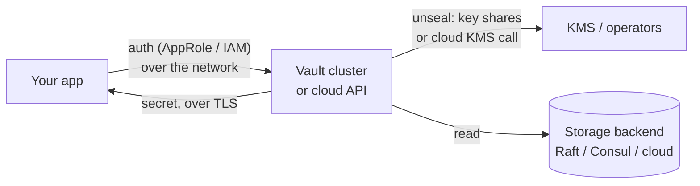
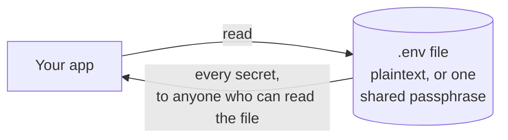
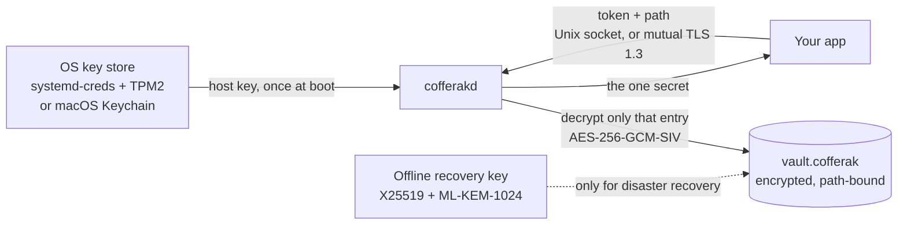

# What cofferak is

**cofferak** keeps application secrets (API keys, database passwords,
tokens) in a single encrypted file and serves them to your services
through a small daemon, `cofferakd`. The key that decrypts the vault is
sealed by the operating system itself - `systemd-creds` (with the TPM2
when present) on Linux, Keychain on macOS - so there is never a plaintext
master key on disk. Each service gets its own token, limited to the paths
and permissions you grant it.

By default `cofferakd` listens only on a local Unix socket. Turn on
**[server mode](server-mode.md)** and it is also reachable over the
network through TLS 1.3 with mandatory mutual TLS, using the same
protocol and the same tokens.

## What "military-grade" and "superfast" mean here

Both claims are specific and checked on every commit:

- **Military-grade** = the NSA's CNSA 2.0 algorithms (the suite for
  protecting classified national-security systems) for everything that
  encrypts or exchanges keys: AES-256 for data, ML-KEM-1024 (FIPS 203,
  post-quantum, the only ML-KEM size CNSA 2.0 accepts) for the recovery
  key and as the preferred TLS key exchange, SHA-384 for key derivation
  and TLS. Certificates use ECDSA P-384 (CNSA 1.0) until TLS libraries
  support ML-DSA certificates. All of it runs on AWS-LC, a FIPS 140-3
  validated module. Details and test evidence:
  [ADR 0011](adr/0011-cnsa-grade-crypto-and-hardened-transport.md).
- **Superfast** = decrypting a secret takes **0.24-0.26 µs**, large
  values stream at **1.4 GB/s (Apple M3 Pro) to 4.3 GB/s (x86-64 Linux
  CI runner)**, and a complete local read through the daemon has a
  **~83 µs** median latency on both. Reproduce with
  `./scripts/bench.sh`, CI runs it on every build. Full table:
  [docs/benchmarks.md](benchmarks.md).

## Highlights

- **Envelope encryption** - one AES-256-GCM-SIV data key (DEK), wrapped
  per host and once for an offline recovery key, every ciphertext is
  bound to its path, so ciphertexts can't be swapped between secrets.
- **Post-quantum recovery key** - the recovery wrap uses X25519 *and*
  ML-KEM-1024 together, so a copy of the vault stolen today stays safe
  against a future quantum computer.
- **OS-sealed host keys** - the unseal key never sits next to the vault
  as a plain file, on Linux the daemon runs unprivileged and receives it
  from systemd.
- **Mandatory mutual TLS for remote access** - TLS 1.3 only, AES-256-GCM
  only, ML-KEM-1024 key exchange preferred, and no connection without a
  client certificate you issued.
- **Least-privilege tokens** - each service is scoped to path prefixes
  with read, write or read-write access.
- **Durable, crash-safe writes** - every acknowledged write is already on
  disk, written atomically under a lock.
- **Audit log** - every request, allowed or denied, is recorded.
- **Disaster recovery** - rebuild access on a new machine with the
  offline root key.
- **Easy migration** - import `.env` files, run apps without them, and
  move a whole vault to another machine or OS with one encrypted bundle.
- **Client SDKs** - Rust, Go, Python and TypeScript/JavaScript, each
  tested against a real daemon in CI over the Unix socket and mTLS.

> **Status: v0.1.0, pre-1.0.** Feature-complete and tested on every
> commit on Linux and macOS, including real systemd-creds sealing, a
> non-root systemd service, and TLS/mTLS for every SDK. The on-disk
> format and wire protocol may still change before 1.0. See
> [`docs/PROGRESS.md`](PROGRESS.md) for what is proven and the
> known limitations.

## Why cofferak

Most secrets-management setups either hand you a server to operate
(HashiCorp Vault, a cloud KMS) or a flat file with one shared passphrase.
cofferak is neither: it's an **envelope-encryption** vault where the key
that decrypts your secrets is itself sealed by the operating system's own
secure-storage primitive - `systemd-creds` on Linux, Keychain on macOS -
so the unseal key is never a plaintext file sitting next to the vault.

How an application gets one secret, in each model:

**HashiCorp Vault / cloud secrets manager** - a separate service you run
(or rent), reached over the network, unsealed by key shares or a cloud
KMS:

**`.env` / encrypted file** - no server, but the secret (or the one
passphrase that opens every secret) sits next to the app:

**cofferak** - the vault lives on the same host, the OS unseals the key
once at boot, each app asks for only the paths its token allows:

| | Vault / cloud manager | `.env` file | cofferak |
|---|---|---|---|
| Something extra to operate | A cluster or a cloud account | Nothing | One small daemon per host |
| Where the unlock key lives | Key shares / external KMS | Next to the app (or no key) | Sealed by the OS (TPM2 / Keychain) |
| Network hop to read a secret | Yes | No | No (Unix socket), optional mTLS |
| Per-app least privilege | Yes (policies) | No | Yes (path-prefix tokens) |
| Post-quantum recovery path | Depends on setup | No | Yes (ML-KEM-1024 hybrid) |

- **No external dependency.** No third-party server to run, no account
  to create, no call out to any third-party KMS. `cofferakd` is the only
  server involved, and it's yours - local Unix socket by default, or
  your own mutual-TLS endpoint if you turn on server mode.
- **One codebase, two platforms.** `cofferak-core` (crypto, on-disk
  format, ACL) is entirely platform-agnostic, only the small `HostSeal`
  trait has a platform-specific implementation, so the same logic - and
  the same tests - run on both Linux and macOS.
- **Per-service, least-privilege access.** Consumers get a scoped
  capability token (path prefix + read/write), not a master key.

For an honest comparison with `.env` files, HashiCorp Vault, Infisical
and AWS Secrets Manager - including when one of those fits better - see
[`docs/comparison.md`](comparison.md).

## How it works

- A **root keypair** (X25519 + ML-KEM-1024) is generated once. Its
  private half is printed once, as an armored block, for the operator to
  store off-machine, it is never kept on any host running the daemon.
- A random 256-bit **DEK** (Data Encryption Key) encrypts the secrets
  store (AES-256-GCM-SIV, each value bound to its path). It is never
  stored unwrapped: it's wrapped once per enrolled host (under that
  host's sealed unseal key) and once under the root public key with the
  hybrid post-quantum KEM (for disaster recovery).
- Each enrolled **host** has its own random unseal key, sealed by the
  platform's `HostSeal` backend so it is only recoverable on that
  specific host, inside the daemon process.
- Each enrolled **service** gets an access token scoped to a set of path
  prefixes and a permission level (read / write / read-write) - never
  the DEK itself.

See [`docs/SPEC.md`](SPEC.md) for the full design, including the
on-disk format, the daemon's request protocol, and the disaster-recovery
flow, and [`docs/adr/`](adr/README.md) for the point decisions behind it.
